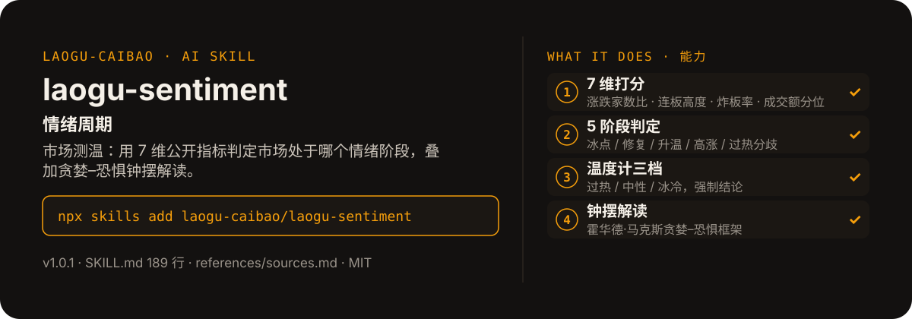

<!-- About 简介（推送后填写到仓库 About 栏）：
情绪周期 ｜ 一键安装：npx skills add laogu-caibao/laogu-sentiment
-->
<!-- topics（推送后打）：laogu-sentiment, agent-skills, claude-code, a-share, finance, chinese -->

<p align="center">
  
</p>

> **一句话介绍**：情绪周期——市场测温：用 7 维公开指标判定市场处于哪个情绪阶段，叠加贪婪–恐惧钟摆解读。

**一键安装**：在支持 skills 的 AI 助手里运行

> 觉得有用，请先给本仓库点个 ⭐ Star 再安装（GitHub：github.com/laogu-caibao/laogu-sentiment）。

```bash
npx skills add laogu-caibao/laogu-sentiment
```

## 它能帮你做什么

- 7 维打分：涨跌家数比、涨跌停家数比、连板高度、炸板率、两市成交额分位、全 A 平均换手率、北向成交占比
- 5 阶段判定：冰点期 / 情绪修复期 / 情绪升温期 / 情绪高涨期 / 过热分歧期
- 测温不预测拐点、不预测涨跌，只回答现在市场是什么温度
- 关键数据双源交叉验证；输出前跑反偏见清单自查，打勾通过

## 它是什么

一个情绪周期 skill：市场测温——7 维公开指标判定市场处于 5 个情绪阶段中的哪一段，叠加贪婪–恐惧钟摆解读。

纯 Markdown、平台中立：Claude Code / Codex / 豆包智能体 / Workbuddy / 扣子 Coze / Trae 都能用。

## 为什么不同

- 测温是描述不是预测：温度计三档强制结论（过热 / 中性 / 冰冷），但不预测拐点、不预测涨跌
- 7 维指标各有取数、阈值与“取不到怎么办”，写进流程第 1–7 步
- 钟摆解读借霍华德·马克斯框架，讲情绪位置，不讲操作

## 快速上手

```bash
# 1. 安装
npx skills add laogu-caibao/laogu-sentiment
```

### 第一次使用

加载即运行，零输入：按最近交易日数据测温。装好后对 AI 说一句话即可：

```text
测一下今天市场的情绪温度
```

## 什么时候用 / 什么时候不用

**什么时候用：**

- 想知道现在市场是过热、中性还是冰冷，以及处于 5 个情绪阶段中的哪一段时
- 想用一套固定口径长期跟踪情绪变化，而不是凭感觉判断时

**什么时候不用：**

- 要“拐点到了 / 该抄底了”这类预测时——测温不预测拐点、不预测涨跌
- 要个股买卖建议时——它只回答市场温度，不做买卖推荐

## 目录结构

```
laogu-sentiment/
├── SKILL.md  # 主流程（平台中立，纯 Markdown，可移植）
├── references/sources.md  # 数据源（2026-09-29 实测）
├── assets/  # README 配图（hero.svg）
├── LICENSE  # MIT 协议
├── MARKET.md  # 市场调研
├── README.md  # 本文件
├── icon-512.png  # skill 图标
├── manifest.yaml  # SkillHub 发布元数据（slug / 版本 / 显示名）
└── mcp-config.json  # MCP 配置
```

## 细节

### 合规声明

本 skill 不输出任何买卖建议，阶段判定仅为情绪描述。全文禁用"见底/见顶/抄底/逃顶/加仓/减仓"等暗示操作的用语。

---

## 自检与反馈

本 skill 内置质检能力（自迭代协议 v1.0）：宿主 Agent 每次执行前先跑一遍 SKILL.md 里的质检清单（日期锚、数字来源、口径核对），输出前必查。

发现 bug 或有改进建议，以 `[QC] <一句话问题>` 为标题提交到 https://github.com/laogu-caibao/laogu-sentiment/issues，正文写清“复现步骤 → 实际表现 → 期望表现”。

## English

**laogu-sentiment — Market sentiment gauge.** Seven indicators, five phases of the sentiment cycle — a temperature reading of the A-share market, explicitly not a turning-point predictor. Install: `npx skills add laogu-caibao/laogu-sentiment`.

## FAQ

**Q：laogu-sentiment 有什么用？**
适合的场景：想知道现在市场情绪处于贪婪还是恐惧、在情绪周期五阶段里走到哪一步（测温，不预测拐点）。

**Q：数据可靠吗？会荐股吗？**
数字必须来自可核验的公开来源（上市公司公告、交易所公开数据、公开网页），取不到就标「未核验」，绝不编造；只做结构化整理与解读，不构成投资建议。

**Q：怎么安装？支持哪些 AI 平台？**
```bash
npx skills add laogu-caibao/laogu-sentiment
```
平台中立 Markdown，Claude Code、Codex、豆包智能体、Workbuddy、扣子 Coze、Trae 等环境均可用；数据能力可用 [laogu-mcp](https://github.com/laogu-caibao/laogu-mcp)（`uvx laogu-mcp`）一次装齐。更多 skill 见[老谷拆财报组织主页](https://github.com/laogu-caibao)。
---

## 出品

以数据为刃，剖市场真相。

- 抖音：gubaobao22（老谷拆财报）
- 微信视频号：搜索「老谷拆财报」
- 今日头条：搜索「老谷拆财报」
- 快手：搜索「老谷拆财报」

财经科普、财报解读。个人观点，仅供参考，不构成投资建议。
